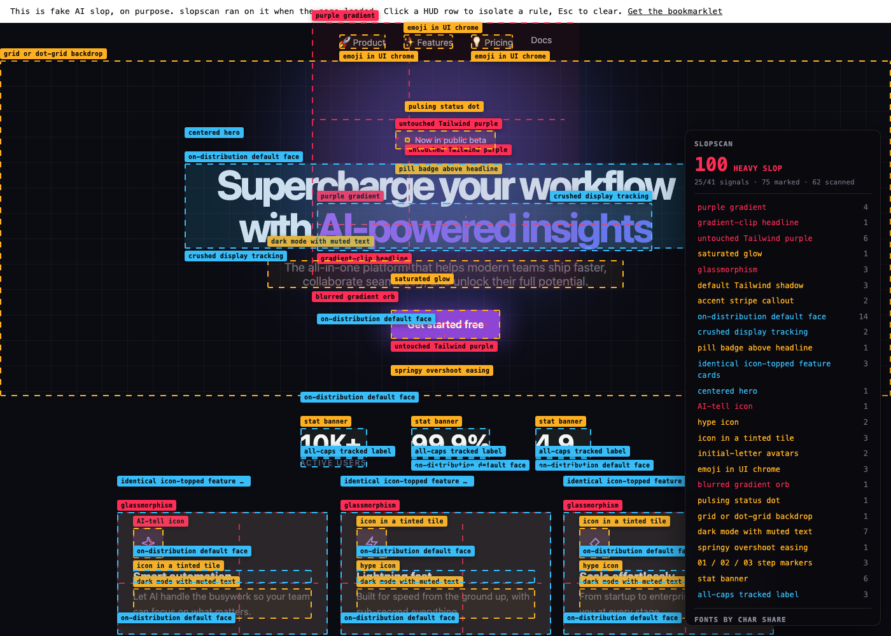

<h1 align="center">slopscan</h1>

<p align="center">
  <b>Spot AI-slop UI on any page, marked right where it happens.</b><br>
  41 deterministic rules over computed CSS. No model, no network, nothing leaves the page.
</p>

<p align="center">
  <a href="https://agamm.github.io/slopscan/"></a>
  &nbsp;
  <a href="https://agamm.github.io/slopscan/demo.html"></a>
</p>

<p align="center">
  
  
  
</p>

<p align="center">
  <a href="https://agamm.github.io/slopscan/demo.html"></a>
</p>

## Install

1. Show your bookmarks bar: <kbd>Cmd</kbd>/<kbd>Ctrl</kbd> + <kbd>Shift</kbd> + <kbd>B</kbd>
2. Click **Get the bookmarklet** above and drag the black **slopscan** button onto the bar
3. Open any site and click it. <kbd>Esc</kbd> clears.

> [!TIP]
> Drag not working? Make a bookmark by hand and paste `dist/bookmarklet.txt` as its URL.
> Site blocks bookmarklets? Paste `dist/slopscan.js` into the devtools console.

GitHub strips `javascript:` links, which is why the button lives on the install page and not here.

## What it catches

| | Severity | Examples |
|---|---|---|
| 🔴 | **P0**: screams AI on sight | purple gradient, gradient-clip headline, untouched Tailwind purple, glassmorphism, blurred gradient orb, sparkles icon, template display font over Inter |
| 🟠 | **P1**: the obvious smell | pill badge above the headline, pulsing "live" dot, icon in a tinted tile, stat banner, 01 / 02 / 03 steps, coloured glow, grid backdrop, initial-letter avatars, one radius everywhere |
| 🔵 | **P2**: cosmetic | centered hero, identical icon cards, hairline on every card, crushed headline tracking, cream background, content hidden until scroll |

The **distributions** block in the HUD is the most reliable signal. Designed pages spread across
many radius and spacing values. Template output piles onto one or two.

<details>
<summary><b>All 41 rules</b>, by file in <code>src/rules/</code></summary>

<br>

| File | Rules |
|---|---|
| `color` | gradient-purple, tw-purple, gradient-text, colored-glow, cream-bg, gray-on-color |
| `surface` | glassmorphism, radius-monoculture, tw-shadow, accent-stripe, uniform-spacing, oversized-shadow, corner-nesting, thin-border-wide-shadow |
| `type` | font-pairing, font-template, mono-body, flat-hierarchy, font-default, crushed-tracking |
| `layout` | hero-keyword, eyebrow-pill, centered-hero, icon-card-grid |
| `iconography` | ai-icon, icon-tile, emoji-ui, hype-icon, letter-avatar |
| `effects` | blur-orb, perma-dark, numbered-steps, stat-banner, hairline-everywhere, springy-easing, nested-cards, allcaps-label, pulsing-dot, grid-background, radial-glow, scroll-reveal |

Thresholds borrow from [slop-detect](https://github.com/ravidsrk/slop-detect),
[design-slop-cop](https://github.com/AdrianKrebs/design-slop-cop) and
[Impeccable](https://github.com/pbakaus/impeccable), checked against live sites.

</details>

## Using the overlay

| Do this | To get |
|---|---|
| Click a HUD row | Only that rule's boxes |
| Hover a label | Why the rule fired |
| Click a label | The element logged to the console |
| Click **copy for AI** | Every finding plus the page URL and state on your clipboard, ready to paste into Claude Code |
| <kbd>Esc</kbd> | Overlay removed |
| `window.__slopscan__` | The full report |

## Adding a rule

<details>
<summary>Add an object to the matching file in <code>src/rules/</code>, then run <code>node build.mjs</code></summary>

<br>

```js
{
  id: 'gradient-purple', label: 'purple gradient', severity: P0, weight: 12,
  why: 'The indigo-to-violet gradient is the single most recognisable AI design tell.',
  test(node, page) {   // evidence string, or null
    return /gradient\(/.test(node.bgImage) ? 'linear-gradient' : null;
  },
}
```

Styles are pre-read in `src/lib/collect.js`, so never call `getComputedStyle` inside a rule.

</details>

## Limitations

> [!NOTE]
> - The score is a first-guess weighted sum, not calibrated. Read the rule list, not the number.
> - Single-feature rules misfire on good sites (linear.app trips `glassmorphism`).
> - Visuals only: no judgement of copy or taste.

<p align="center"><sub>MIT licence</sub></p>
